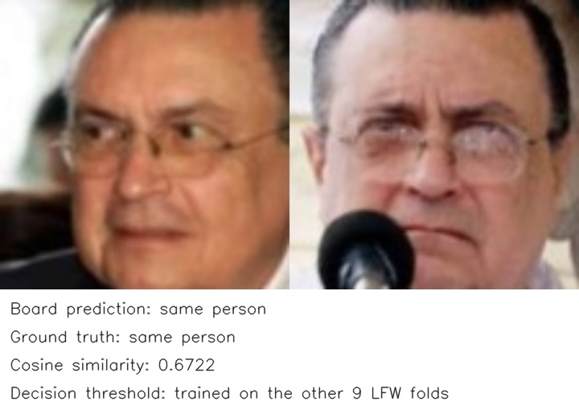
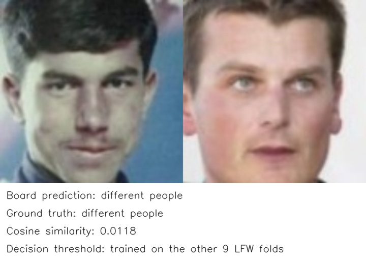
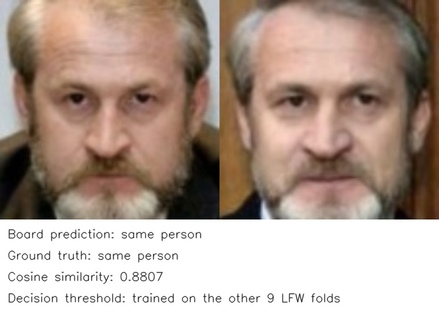

# MobileFaceNet

> Python 推理代码已迁移,尚未做板端验证.下文报告和示例属于迁移前的 C++/原生 CLI 实现,不能作为当前 Python 实现的精度、性能或 RSS.

人脸特征提取与验证，输入为对齐后的 112×112 RGB 人脸。模型不包含人脸检测、活体检测或开放集拒识。来源见[模型卡](model_card.md)。

量化方式: INT8 训练后量化 (PTQ),采用逐输出通道权重量化.

## 执行范围

先在已有编译容器执行 `bash deploy/compile.sh`,完成转换、量化、编译与上传后结束.随后登录开发板,在部署目录执行 `bash compile.sh`,做少量通路检查并保存 README 示例到 `examples/output/`.该阶段计算并打印子集任务精度,不发布正式报告,不统计性能和峰值 RSS.

正式评价使用独立的 `evaluate.sh`: 容器端只计算已有浮点模型的同协议参考及必要评价输入,资源单独放入已有部署包后,板端运行 `bash evaluate.sh`,统计精度、性能和推理进程峰值 RSS.正式结果只写入 `results/summary.json`,不重新量化或编译.板端预测、日志及内部指标统一位于本模型部署目录的 build/work/,每次开始推理时覆盖上次中间结果.详见[板端规范](../../../../docs/genio_720.md).

下文已归档结果保留原始模型版本和评价范围,本次入口调整不代表重新实测.

## 第一步: 编译并上传

模型、数据集和部署路径见 [config.yaml](config.yaml),工具链与 NAS 根目录按[仓库说明](../../../../README.md)配置.

校准默认按文件名排序选取 100 张对齐人脸,数量由 `config.yaml` 的转换参数配置.支持 JPG、JPEG 和 PNG,保留原始文件名即可,不要求添加 `_aligned` 标记.

在编译主机的本模型目录运行:

```bash
bash deploy/compile.sh
```

入口在当前容器完成转换、DLA 编译和上传。

## 第二步: 独立评价

上传完成后,请登录开发板,在部署目录执行 `bash compile.sh` 完成通路检查和示例生成.正式评价前,按[板端规范](../../../../docs/genio_720.md)准备同协议参考及必要输入,在已部署目录执行:

```bash
bash evaluate.sh
```

精度、性能和峰值 RSS 统一保存到 results/summary.json,板端过程数据位于本模型部署目录的 build/work/,每次开始推理时覆盖,不重新量化或编译.

## 数据与精度评测

参考评价使用 `config.yaml` 指定的数据集,与板端保持相同样本、标注和预后处理协议.

数据目录要求: 对齐后的 LFW 包含 `images/`、`pairs.csv` 和 `alignment_summary.json`,覆盖 7701 张验证图、6000 对及 10 折.原始图片与对齐图片分别保存,编译主机和板端配置均指向对齐数据目录.

板端核对对齐报告、验证对及图片完整性,不要求额外的 `source_manifest.json`.

精度变化以百分点表示,正数为改善,负数为下降.

Docker 需要 ONNX Runtime、NumPy、OpenCV 和 tqdm。

## 当前测试结果

LFW 全量 6000 对,采用 MTCNN 五点对齐后的 7701 张人脸,进行十折验证.结果见 [summary.json](results/summary.json).

| 指标 | 结果 |
| --- | ---: |
| ONNX FP32 LFW 验证准确率 | 99.38% |
| 板端 NPU LFW 验证准确率 | **99.32%** |
| 精度变化 | **-0.07 个百分点** |
| 板端 NPU 平均耗时 | **0.52 ms** |
| 推理进程峰值 RSS | **8.25 MiB** |

耗时由独立 C++ 常驻模型预热 10 次、重复同一输入 100 次测得,不包含人脸检测、对齐或前后处理.峰值 RSS 为该 C++ 推理进程的峰值,不代表 NPU 专用内存或全量 Python 评测进程的内存.

## 效果示例

两张人脸并排,显示余弦相似度和同人判定.判定使用对应 LFW 十折验证阈值.

输入已放在 `examples/input/`,编译时从配置的数据集自动生成来源与样本清单,随部署上传,不纳入 Git.

compile.sh 复用固定少量样本的板端预测,生成展示文件到部署目录的 `examples/output/`,不依赖全量评价.
以下三组输出来自本次全量测试的板端预测,保存在 `examples/output/`,展示余弦相似度和十折验证阈值下的同人判定.

| 示例 | 人脸 A | 人脸 B | 真实关系 |
| --- | --- | --- | --- |
| 1 |  |  | 同一人 |
| 2 |  |  | 不同人 |
| 3 |  |  | 同一人 |

### 示例 1: 同一人



### 示例 2: 不同人



### 示例 3: 同一人



## 板端部署结构

第一步上传到 `BOARD_DEPLOY_DIR` 后的布局统一为:

```text
部署目录/
├── compile.sh
├── evaluate.sh          # 独立精度、性能与 RSS 评价.
├── config.json
├── models/              # 模型与推理所需参数.
├── board/               # 板端程序、评测代码及必要依赖.
├── examples/            # 少量输入、来源清单和展示输出.
└── results/summary.json  # 唯一正式评价报告.
```

评价结果只保存在部署目录的 `results/summary.json`.板端预测、日志和中间指标统一保存在本模型部署目录的 `build/work/`,每次开始推理时覆盖;展示示例保存在 `examples/output/`.取回唯一报告后据实更新 README.
## 文件结构

- `deploy/compile.sh`: 编译部署与展示示例入口;精度、性能和 RSS 使用独立的 `deploy/evaluate.sh`.
- `deploy/host/`: 编译主机使用的导出、转换与辅助工具.
- `deploy/board/`: 板端程序源码、预处理和评测代码.
- `models/`: 原始权重、转换产物与来源说明; 必要的上游源码放在 `models/upstream/`.
- `examples/`: 少量固定输入与实际板端效果输出.
- `results/summary.json`: 上传后的最新测试汇总.

### 输出误差统计

compile.sh 独立对固定少量输入比较浮点与 NPU 输出,在终端显示 CosSim、RMSE、NRMSE 和实际覆盖范围.普通模型最多选择 5 次输入,不减少原有 compile 通路检查样本数;LLM 比较示例首个 Prefill 块的有效位置,BEVFusion 比较单帧的 NPU 子图.这些结果用于数值检查,不能代替任务精度.全量 evaluate.sh 只计算任务精度、性能和 RSS,不保存或比较全量浮点张量.

参考为普通 NPZ 数组文件,保存在编译机器本地日期临时目录并上传板端 build/reference/output_reference.npz,由下次 compile 覆盖,不使用数据库,不写入 NAS.板端中间结果仍使用本模型 build/work/.NRMSE 定义为 100 × RMSE / RMS(浮点参考),多输出分别统计.详见[输出误差统计](../../../../docs/output_metrics.md).

### compile 子集精度检查

compile.sh 使用 500 对 LFW 图片,每折 25 对同人与 25 对异人,复用正式评价协议.主机执行子集浮点推理,板端执行同一子集 NPU 推理,在终端打印精度和损失,并保存 results/summary_test.json.正的损失表示 NPU 变差,负值表示改善;Top-1、AP、AR 等使用浮点减 NPU 的百分点,WER 使用 NPU 减浮点的百分点,PPL 使用增量及相对增幅.

普通样本跨完整划分按固定间隔抽取,保留展示及数值检查的必要输入;LFW、ESC-50 和 MMLU 保持折、类别和学科覆盖.同一子集两端通过样本指纹核对;MMLU 固定 seed=17 分层抽样.该报告不代表全量成绩,不改写 results/summary.json.中间数据覆盖保存在本模型 build/work/,CosSim、RMSE、NRMSE 仍只比较固定少量输入.详见[输出误差统计](../../../../docs/output_metrics.md).
