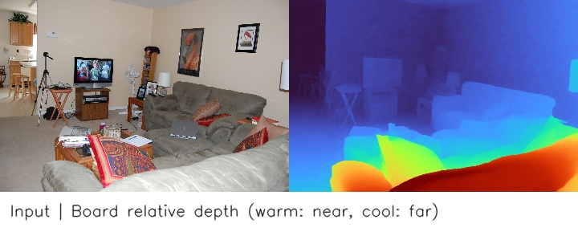
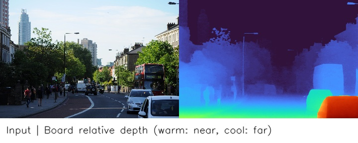
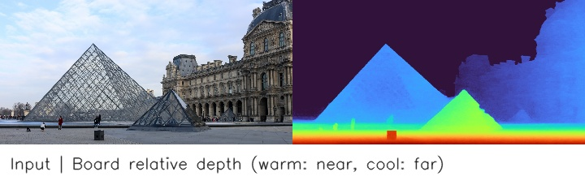

# Depth Anything V2 Small

> Python 推理代码已迁移,尚未做板端验证.下文报告和示例属于迁移前的 C++/原生 CLI 实现,不能作为当前 Python 实现的精度、性能或 RSS.

单目相对深度估计，输入为 518×518 RGB 图像。输出只表达单张图内的相对结构，不能直接用于米制测距。来源见[模型卡](model_card.md),资源下载地址见 [source_url.txt](models/source_url.txt)。

量化方式: INT8 训练后量化 (PTQ),采用逐输出通道权重量化.

## 执行范围

先在已有编译容器执行 `bash deploy/compile.sh`,完成转换、量化、编译与上传后结束.随后登录开发板,在部署目录执行 `bash compile.sh`,做少量通路检查并保存 README 示例到 `examples/output/`.该阶段不计算或发布精度、性能和峰值 RSS 报告.

正式评价使用独立的 `evaluate.sh`: 容器端只计算已有浮点模型的同协议参考及必要评价输入,资源单独放入已有部署包后,板端运行 `bash evaluate.sh`,统计精度、性能和推理进程峰值 RSS.正式结果只写入 `results/summary.json`,不重新量化或编译.预测、日志及内部指标位于当天日期临时目录.详见[板端规范](../../../../docs/genio_720.md).

下文已归档结果保留原始模型版本和评价范围,本次入口调整不代表重新实测.

## 第一步: 编译并上传

模型、数据集和部署路径见 [config.yaml](config.yaml),工具链与 NAS 根目录按[仓库说明](../../../../README.md)配置.

在编译主机的本模型目录运行:

```bash
bash deploy/compile.sh
```

转换、编译、参考评价和上传均在当前容器内完成。

## 第二步: 独立评价

上传完成后,请登录开发板,在部署目录执行 `bash compile.sh` 完成通路检查和示例生成.正式评价前,按[板端规范](../../../../docs/genio_720.md)准备同协议参考及必要输入,在已部署目录执行:

```bash
bash evaluate.sh
```

精度、性能和峰值 RSS 统一保存到 results/summary.json,过程数据位于日期临时目录,不重新量化或编译.

## 数据与精度评测

参考评价使用 `config.yaml` 指定的数据集,与板端保持相同样本、标注和预后处理协议.

数据目录要求: DA-2K: images/ 和 annotations.json,1033 张图片、2068 个点对.

精度变化以百分点表示,正数为改善,负数为下降.

Docker 需要 ONNX Runtime、NumPy、OpenCV 和 tqdm。

## 当前测试结果

DA-2K 全量 1033 张图片、2068 个点对,结果见 [summary.json](results/summary.json).

| 指标 | 结果 |
| --- | ---: |
| ONNX FP32 点对准确率 | **94.83%** |
| 板端 NPU 点对准确率 | **85.78%** |
| 精度变化 | **-9.04 个百分点** |
| 板端 NPU 平均耗时 | **133.02 ms** |
| 推理进程峰值 RSS | **33.04 MiB** |

耗时由独立 C++ 常驻模型预热 10 次、重复同一输入 100 次测得,不包含前后处理.峰值 RSS 为该 C++ 推理进程的峰值,不代表 NPU 专用内存或全量 Python 评测进程的内存.精度变化为本次板端准确率减同协议 ONNX FP32 准确率.

## 效果示例

原图与板端相对深度图并排,暖色表示较近,冷色表示较远.

输入已放在 `examples/input/`,编译时从配置的数据集自动生成来源与样本清单,随部署上传,不纳入 Git.

compile.sh 复用固定少量样本的板端预测,生成展示文件到部署目录的 `examples/output/`,不依赖全量评价.
以下三张输出来自本次全量测试的板端预测,保存在 `examples/output/`.示例目录仅保留三张输入和三张对应输出.

### 示例 1: 室内场景



### 示例 2: 室外街景



### 示例 3: 玻璃建筑



## 板端部署结构

第一步上传到 `BOARD_DEPLOY_DIR` 后的布局统一为:

```text
部署目录/
├── compile.sh
├── evaluate.sh          # 独立精度、性能与 RSS 评价.
├── config.json
├── models/              # 模型与推理所需参数.
├── board/               # 板端程序、评测代码及必要依赖.
├── examples/            # 少量输入、来源清单和展示输出.
└── results/summary.json  # 唯一正式评价报告.
```

评价结果只保存在部署目录的 `results/summary.json`.预测、日志和中间指标保留在 `/tmp/hailongcodex/<当天日期>/<模型>_evaluate_<运行编号>/`;展示示例保存在 `examples/output/`.取回唯一报告后据实更新 README.
## 文件结构

- `deploy/compile.sh`: 编译部署与展示示例入口;精度、性能和 RSS 使用独立的 `deploy/evaluate.sh`.
- `deploy/host/`: 编译主机使用的导出、转换与辅助工具.
- `deploy/board/`: 板端程序源码、预处理和评测代码.
- `models/`: 原始权重、转换产物与来源说明; 必要的上游源码放在 `models/upstream/`.
- `examples/`: 少量固定输入与实际板端效果输出.
- `results/summary.json`: 上传后的最新测试汇总.

### 输出误差统计

`evaluate.sh` 同时计算 CosSim、RMSE 和 NRMSE,写入唯一 `results/summary.json` 的 `output_comparison`.浮点参考生成时保存 output_reference.sqlite,与任务参考一起放入板端 models/;按量化前输入内容配对,在现有 NPU 评价过程中逐输出累计统计.NRMSE 使用 `RMSE / RMS(浮点参考输出) × 100%`;多输出分别统计,缺参考如实记录缺失.具体定义、资源位置及当前未实测边界见[输出误差统计](../../../../docs/output_metrics.md).本次仅增加统计代码,未重新执行评价,历史指标不代表新增统计已验证.
