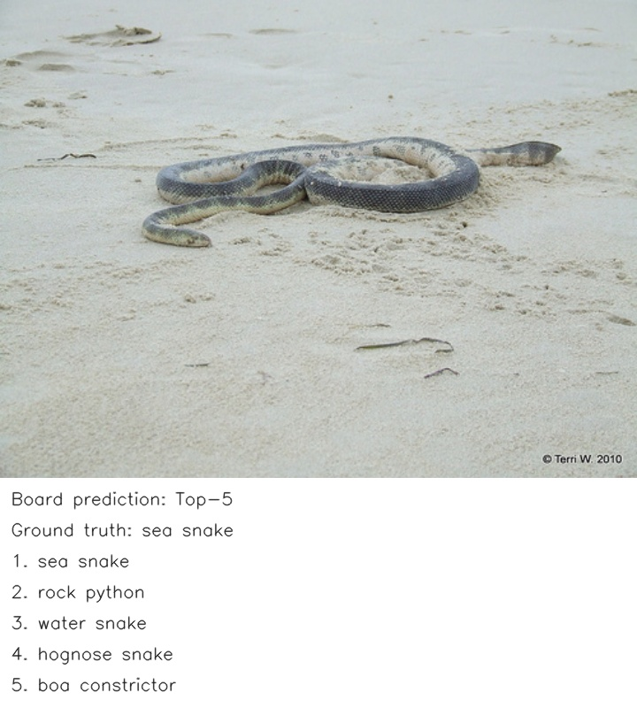
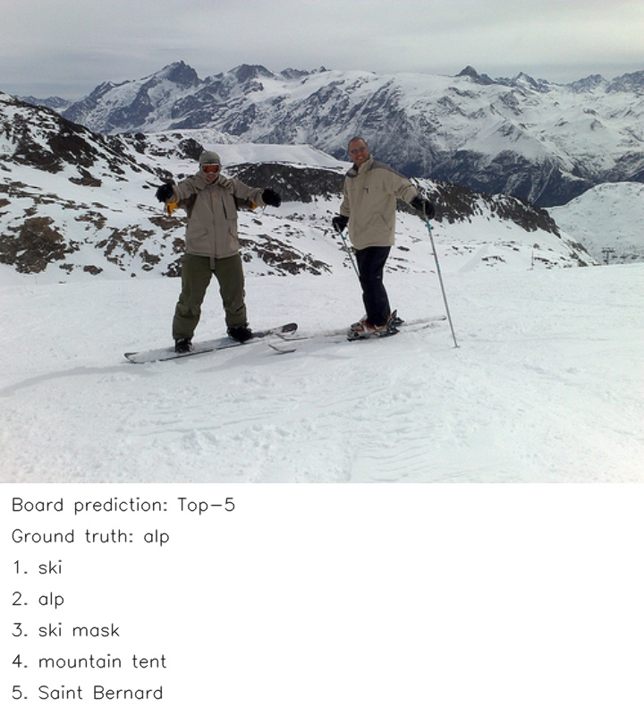
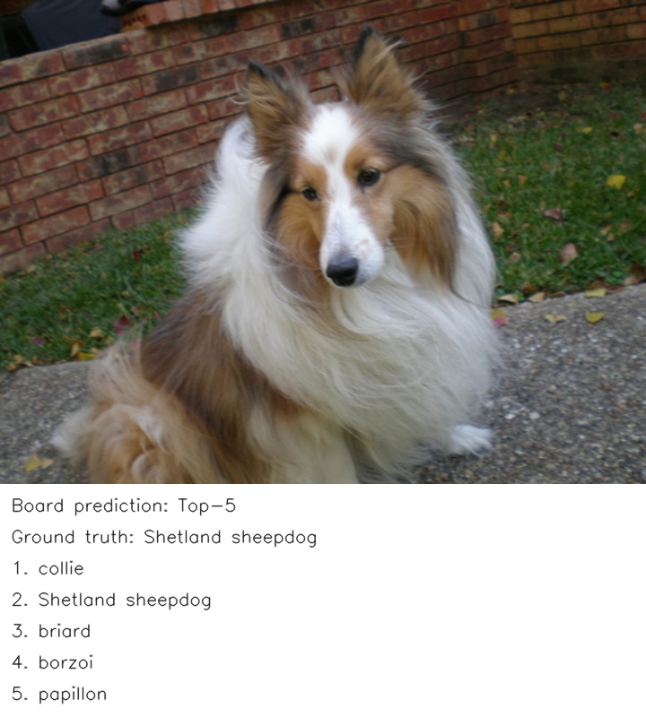

# ResNet101

采用 TorchVision `v0.15.1` 的 `ResNet101_Weights.IMAGENET1K_V2`,用于 ImageNet-1K 的 1000 类图像分类.当前已实现离线导出、INT8 PTQ、G720 编译上传和 Python 板端流程;编译与硬件验证状态见下文.正式来源为 [pytorch/vision](https://github.com/pytorch/vision/tree/v0.15.1),Qualcomm 页面仅作交付形式参考.

## 权重与数据

请自行下载官方权重 [resnet101-cd907fc2.pth](https://download.pytorch.org/models/resnet101-cd907fc2.pth),约 170.5 MiB,放入本地 `models_root/perception/image_classification/resnet101/`.脚本使用 `weights=None` 创建网络,只加载该本地文件,不会自动下载权重或安装依赖.完整来源见 [models/source_url.txt](models/source_url.txt).

模型参数见 [config.yaml](config.yaml).`models_root`、`dataset_root` 和平台连接信息由仓库本地存储及平台配置提供,公开文件不保存实际地址.默认数据布局为:

```text
dataset_root/ImageNet/
├── ILSVRC2012_img_val/          也可使用 val/,校准路径需在模型配置中对应调整.
│   ├── ILSVRC2012_val_00000001.JPEG
│   ├── ...
│   └── ILSVRC2012_val_00050000.JPEG
└── val_labels_0based.txt
```

标签按上述图片编号排列,每行一个 TorchVision 零基类别 ID,共 50000 行;也接受从 1 开始的连续行号加类别 ID 两列.必须由 ImageNet devkit 的类别信息映射到 TorchVision 类别顺序,不能直接将 devkit 原始标签减 1.数据来自 [ILSVRC2012 官方入口](https://image-net.org/challenges/LSVRC/2012/),遵守其访问和使用条件.

默认校准按文件名排序跳过 1000 张,取之后的 100 张.这是复用验证集的 PTQ 校准,与正式 50000 张验证集有 100 张重叠,不是独立校准集.评价报告同时记录重叠数量和排除这些图片后的 NPU Top-1/Top-5;后者没有独立 FP32 子集参考,不计算差值.若改用独立校准集,须同步调整配置,重新编译后再评价.

## 张量与预处理

| 项目 | 契约 |
| --- | --- |
| 官方模型 | TorchVision ResNet101 V1.5 架构,`IMAGENET1K_V2` 权重,44,549,160 参数 |
| 图像预处理 | PIL RGB,短边缩放至 232,双线性插值,按 TorchVision 规则中心裁剪 224 |
| ONNX 输入 | `image`,FP32 NCHW `[1,3,224,224]`,范围 `[0,1]` |
| 图内归一化 | mean=`[0.485,0.456,0.406]`,std=`[0.229,0.224,0.225]` |
| ONNX 输出 | `logits`,FP32 `[1,1000]`,不包含 Softmax |
| 量化 | W8A8 INT8 PTQ,逐输出通道权重量化;偏置等张量不宣称为 INT8 |
| 原生 I/O | 从实际 TFLite 提取逐张量 INT8 scale/zero point;不符合 dtype 或形状时停止 |
| DLA 布局 | 要求连续存储或最后一维补齐到 16 字节,运行时核对 SDK 实际缓冲区大小 |
| 类别排序 | Top-5 按分数降序;相同分数按类别 ID 升序,不展示伪造概率 |

校准、ONNX 参考和板端共用 `deploy/board/resnet101.py` 的预处理.归一化已在图内,外部不可重复执行.转换与板端报告分别记录实际 Pillow 版本,预处理兼容性通过同输入对比检查.模型摘要仅保留必要版本绑定,不在终端打印成串校验值.

## 编译并上传

在已有 Ubuntu 编译容器的仓库根目录执行:

```bash
bash models/perception/image_classification/resnet101/deploy/compile.sh
```

入口顺序导出 FP32 ONNX、用 100 张图片校准为 INT8 TFLite、通过公共 NCC 配方编译 MDLA 5.3 DLA,最后上传部署包.使用 `--suppress-output --disallow-bridge`,禁止 CPU bridge.原始权重、ONNX、DLA 和必要参数保存在模型资源目录,转换中间文件使用该目录的 `build/`.编译过程不运行全量 ONNX 参考、精度评分、测速或 RSS 统计.

主机上传后结束,只提示板端路径,不通过 SSH 自动启动板端推理.请登录开发板,进入终端提示的部署目录执行:

```bash
bash compile.sh
```

板端只读取部署包内的三张输入,无需全量数据集;常驻加载 DLA 后通过 Python 直接调用 MTK SDK 动态库执行 NPU 推理,生成 `examples/output/sample_1_classification.jpg` 至 `sample_3_classification.jpg`.展示图片来自本次板端预测,不会复用 ViT 的结果.编译阶段不写正式报告.

主机依赖现有容器中的 PyTorch 2.0.0、TorchVision 0.15.1、ONNX、MTK Converter、NCC、NumPy、Pillow 和 tqdm.板端需要 Python 3.10+、NumPy、Pillow 9.1+、用于结果绘图的 OpenCV,以及匹配板端架构与系统的 Neuron Runtime SDK 8 动态库.代码不部署或覆盖系统动态库.

## 独立评价

在已有编译容器执行:

```bash
bash models/perception/image_classification/resnet101/deploy/evaluate.sh
```

只对已导出的 `model_fp32.onnx` 计算全量 ImageNet Top-1/Top-5,参考保存为资源目录的 `build/onnx_reference.json`.将此文件单独放到已有板端部署包的 `models/onnx_reference.json`,确认板端已有完整验证集和标签,再在部署目录执行:

```bash
bash evaluate.sh
```

板端执行 5 次预热和 50000 张验证图推理,严格核对图片顺序、数量、标签和模型版本,完整后将精度、相对同协议 FP32 的百分点变化、性能和 RSS 发布到唯一 `results/summary.json`.缺参考时保留绝对精度,差值为空并标记 `partial`;存在不匹配参考时直接报错.评价不触发导出、量化、编译或上传.

- 纯 NPU 时间: SDK 同步 `inference` 调用,不含 I/O 绑定与前后处理,报告均值和 P95.
- 端到端时间: 图片读取、预处理、量化、I/O 绑定、NPU 和 Top-5,不含模型加载、预热、预测写盘及评分.
- 峰值 RSS: Python 推理进程全生命周期的高水位,不是设备全部驱动或 NPU 内存.
- 过程数据: `/tmp/hailongcodex/当天日期/resnet101_阶段_运行编号/`,只保存预测和评分所需的推理元数据.

单独运行 `board/infer.py` 默认只检查三张示例;`board/evaluate.py` 默认全量,只评分当天同模型最近一次全量推理结果,缺失时停止,不会补跑推理.两个主要入口无需参数.

## 当前状态

2026-10-23 已完成官方本地权重加载、FP32 ONNX 导出、100 张校准、INT8 TFLite 转换、MDLA 5.3 编译、上传及板端三图 Python NPU 通路检查.本次过程编号为 `20261023_023105_1273829`.未执行全量 `evaluate.sh`,未采集或发布正式精度、性能、RSS,因此没有 `results/summary.json`.

| 产物 / 检查 | 本次实际结果 |
| --- | --- |
| 原始权重 | 178,814,045 bytes |
| FP32 ONNX | 178,039,369 bytes |
| INT8 TFLite | 46,865,112 bytes |
| G720 DLA | 45,377,343 bytes,约 45.38 MB |
| 官方变换对比 | 三张图片的归一化输入与 TorchVision 官方 V2 变换完全一致 |
| FP32 转换对比 | 三张图片的 ONNX 与 PyTorch logits 最大绝对差小于 `6e-6`,Top-1 一致 |
| 主机 / 板端预处理 | Pillow 11.3.0 / 10.3.0,三张输入张量逐字节一致 |
| 板端通路 | Python 3.12.13,实际 SDK NPU 推理 3/3 完成,原生 INT8 I/O 契约检查通过 |

## 实际分类示例

以下图片来自本次板端真实预测,输入为 ImageNet 验证集前三张图片.只展示类别排序,不将三图结果作为全量精度.第三张图片的 NPU Top-1 与 FP32 Top-1 不同,说明量化后的类别排序仍须全量评价.







[TorchVision 官方文档](https://docs.pytorch.org/vision/0.15/models/generated/torchvision.models.resnet101.html)报告该 V2 权重 ImageNet-1K Top-1 为 81.886%,Top-5 为 95.780%;这些是官方浮点参考,不能作为本仓库 ONNX 或 MTK NPU 的实测结果.G5100 尚未适配或验证.
