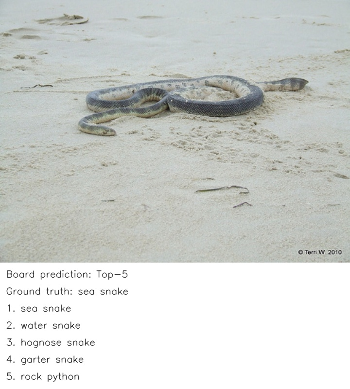
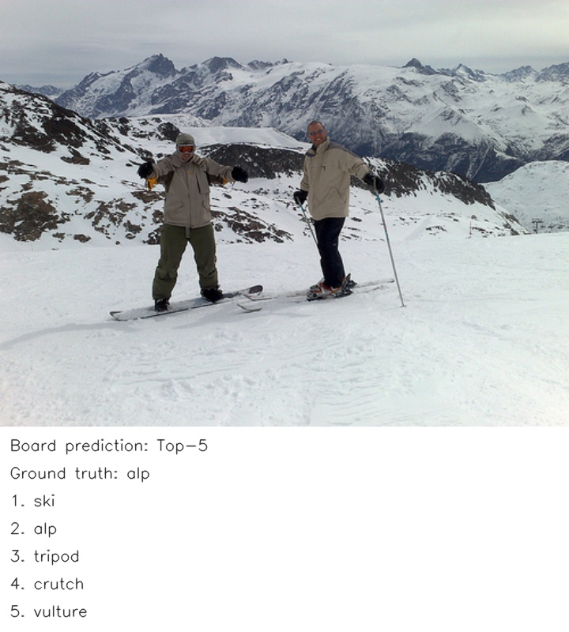
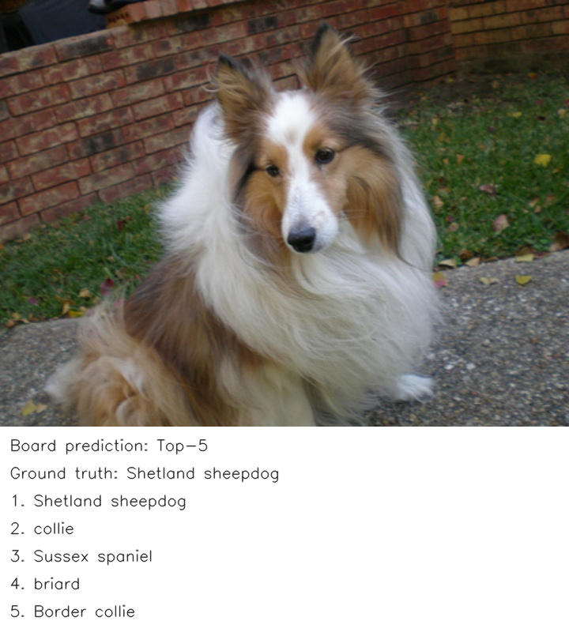

# ViT-Base Patch16 224

> Python 推理代码已迁移,尚未做板端验证.下文报告和示例属于迁移前的 C++/原生 CLI 实现,不能作为当前 Python 实现的精度、性能或 RSS.

ImageNet-1K 图像分类，输入为 224×224 RGB 图像。正式上游为 PyTorch Vision v0.15.1，来源见[模型卡](model_card.md)。

量化方式: INT8 训练后量化 (PTQ),采用逐输出通道权重量化。

## 执行范围

先在已有编译容器执行 `bash deploy/compile.sh`,完成转换、量化、编译与上传后结束.随后登录开发板,在部署目录执行 `bash compile.sh`,做少量通路检查并保存 README 示例到 `examples/output/`.该阶段计算并打印子集任务精度,不发布正式报告,不统计性能和峰值 RSS.

正式评价使用独立的 `evaluate.sh`: 容器端只计算已有浮点模型的同协议参考及必要评价输入,资源单独放入已有部署包后,板端运行 `bash evaluate.sh`,统计精度、性能和推理进程峰值 RSS.正式结果只写入 `results/summary.json`,不重新量化或编译.板端预测、日志及内部指标统一位于本模型部署目录的 build/work/,每次开始推理时覆盖上次中间结果.详见[板端规范](../../../../docs/genio_720.md).

下文已归档结果保留原始模型版本和评价范围,本次入口调整不代表重新实测.

## 第一步: 编译并上传

模型权重、校准与验证数据、输出和板端目录在 [config.yaml](config.yaml) 配置.默认校准按文件名排序跳过前 1000 张,再取 100 张;模型与中间产物写入 NAS 资源目录.

编译主机的验证集图片目录支持 `val/` 或解压后的 `ILSVRC2012_img_val/`,根目录需有 `val_labels_0based.txt`。标签由官方 devkit 的 `meta.mat` 和验证集标签映射为 TorchVision 的 0–999 类别编号,不能直接将官方编号减 1。

在编译主机的本模型目录运行:

```bash
bash deploy/compile.sh
```

入口在当前容器中完成量化、DLA 编译、ONNX 全量 Top-1 评价和上传。Docker 需安装 ONNX Runtime、NumPy、OpenCV、PyTorch、torchvision 和 tqdm。

## 第二步: 独立评价

上传完成后,请登录开发板,在部署目录执行 `bash compile.sh` 完成通路检查和示例生成.正式评价前,按[板端规范](../../../../docs/genio_720.md)准备同协议参考及必要输入,在已部署目录执行:

```bash
bash evaluate.sh
```

精度、性能和峰值 RSS 统一保存到 results/summary.json,板端过程数据位于本模型部署目录的 build/work/,每次开始推理时覆盖,不重新量化或编译.

## 数据与精度评测

ViT compile 评价固定 1000 张子集图片.完整数据仍按下列 ImageNet 50000 张验证图片和零基标签格式准备,全量评价单独执行 `evaluate.sh`:

```text
数据集根目录/
├── val/ 或 ILSVRC2012_img_val/
│   ├── ILSVRC2012_val_00000001.JPEG
│   ├── ...
│   └── ILSVRC2012_val_00050000.JPEG
└── val_labels_0based.txt
```

板端通过 Python 完成图片预处理和 NPU 推理,计算 Top-1、NPU 平均耗时、推理进程峰值 RSS 与相对 ONNX 的精度变化。板端需安装 Python 3、NumPy 和 OpenCV。

评价结果只保存在部署目录的 `results/summary.json`.板端预测、日志和中间指标统一保存在本模型部署目录的 `build/work/`,每次开始推理时覆盖;展示示例保存在 `examples/output/`.取回唯一报告后据实更新 README.

## 当前测试结果

结果来自 [results/summary.json](results/summary.json),运行编号 `20261008_094211_126146`,ImageNet val2012 全量 50000 张图片。

| 指标 | 本次结果 |
| --- | ---: |
| 板端 NPU 平均推理耗时 | **51.75 ms** |
| 板端推理进程峰值 RSS | **141.30 MiB** |
| ONNX FP32 Top-1 | **80.66%** |
| 板端 Top-1 | **79.40%** |
| 精度变化 (百分点) | **-1.27** |

ONNX 与板端使用同一份验证集和评测协议.精度以百分比显示并保留两位小数,变化按原始数值计算,负数表示下降.完整数值保存在 `summary.json` 中。

NPU 耗时为常驻模型对 50000 张图片的 `NeuronRuntime_inference` 平均调用耗时,不含图片读取、前后处理及精度计算.峰值 RSS 为推理进程峰值常驻内存,包含运行库与前后处理,不代表 NPU 专用内存。

## 效果示例

原图下方显示板端 Top-1 与 Top-5 类别排序.

输入已放在 `examples/input/`,选取 [ImageNet val2012](https://image-net.org/challenges/LSVRC/2012/) 的前三张图片: 海蛇、雪山和牧羊犬.来源与样本清单在编译时自动生成并随部署上传,不纳入 Git.

compile.sh 复用固定少量样本的板端预测,生成展示文件到部署目录的 `examples/output/`,不依赖全量评价.
以下三张效果来自本次板端实际推理,复用全量测试样本的预测,未额外运行模型.

### 示例 1: 海蛇



### 示例 2: 雪山



### 示例 3: 牧羊犬



## 板端部署结构

第一步上传到 `BOARD_DEPLOY_DIR` 后的布局统一为:

```text
部署目录/
├── compile.sh
├── evaluate.sh          # 独立精度、性能与 RSS 评价.
├── config.json          # 不含连接地址的模型配置.
├── models/              # 模型与推理所需参数.
├── board/               # 板端程序、评测代码及必要依赖.
├── examples/            # 少量输入、来源清单和展示输出.
└── results/summary.json  # 唯一正式评价报告.
```

评价结果只保存在部署目录的 `results/summary.json`.板端预测、日志和中间指标统一保存在本模型部署目录的 `build/work/`,每次开始推理时覆盖;展示示例保存在 `examples/output/`.取回唯一报告后据实更新 README.
## 文件结构

- `deploy/compile.sh`: 编译部署与展示示例入口;精度、性能和 RSS 使用独立的 `deploy/evaluate.sh`.
- `deploy/host/`: 编译主机使用的导出、转换与辅助工具.
- `deploy/board/`: 板端程序源码、预处理和评测代码.
- `models/`: 原始权重、转换产物与来源说明; 必要的上游源码放在 `models/upstream/`.
- `examples/`: 少量固定输入与实际板端效果输出.
- `results/summary.json`: 上传后的最新测试汇总.

### 输出误差统计

compile.sh 独立对固定少量输入比较浮点与 NPU 输出,在终端显示 CosSim、RMSE、NRMSE 和实际覆盖范围.普通模型最多选择 5 次输入,不减少原有 compile 通路检查样本数;LLM 比较示例首个 Prefill 块的有效位置,BEVFusion 比较单帧的 NPU 子图.这些结果用于数值检查,不能代替任务精度.全量 evaluate.sh 只计算任务精度、性能和 RSS,不保存或比较全量浮点张量.

参考为普通 NPZ 数组文件,保存在编译机器本地日期临时目录并上传板端 build/reference/output_reference.npz,由下次 compile 覆盖,不使用数据库,不写入 NAS.板端中间结果仍使用本模型 build/work/.NRMSE 定义为 100 × RMSE / RMS(浮点参考),多输出分别统计.详见[输出误差统计](../../../../docs/output_metrics.md).

### compile 子集精度检查

compile.sh 使用 1000 张 ImageNet 验证图片,复用正式评价协议.主机执行子集浮点推理,板端执行同一子集 NPU 推理,在终端打印精度和损失,并保存 results/summary_test.json.正的损失表示 NPU 变差,负值表示改善;Top-1、AP、AR 等使用浮点减 NPU 的百分点,WER 使用 NPU 减浮点的百分点,PPL 使用增量及相对增幅.

普通样本跨完整划分按固定间隔抽取,保留展示及数值检查的必要输入;LFW、ESC-50 和 MMLU 保持折、类别和学科覆盖.同一子集两端通过样本指纹核对;MMLU 固定 seed=17 分层抽样.该报告不代表全量成绩,不改写 results/summary.json.中间数据覆盖保存在本模型 build/work/,CosSim、RMSE、NRMSE 仍只比较固定少量输入.详见[输出误差统计](../../../../docs/output_metrics.md).

## 量化参数与编译命令

以下为当前 [config.yaml](config.yaml)、[量化实现](deploy/host/convert_int8.py) 和 [编译实现](deploy/host/compile_model.py) 中的配置.未显式覆盖的 Converter 属性沿用当前 SDK 默认值,实际 scale/zero point 由校准产物读取,不能写死为通用常量.

### 量化设置

| 参数 | 当前设置 |
| --- | --- |
| 转换入口 | `deploy/host/convert_int8.py`,MTK `OnnxConverter` |
| 精度 | W8A8 PTQ,逐输出通道权重量化 |
| 校准 | ImageNet 验证图片按文件名排序,跳过前 1000 张,取 100 张 |
| 输入 | FP32 `[1,3,224,224]`,短边 256、中心裁剪、RGB / 255;mean/std 在图内 |
| 显式设置 | `quantize=True`,`use_per_output_channel_quantization=True`;其余属性沿用当前 SDK 默认值 |
| 量化输入/结果 | `vit_b_16_mtk_compatible.onnx` → `build/model_int8.tflite`,I/O 尺度保存到 `build/quantization.json` |

### 特殊 ONNX 导出处理

[export_onnx.py](deploy/host/export_onnx.py) 将 12 层 MultiheadAttention 改写为最多四维的 Q/K/V、MatMul 和 Softmax,复用原始投影参数;改写前后以同一输入核对,最大绝对差须不超过 `1e-4`.同时将 ImageNet mean/std 放进图内.保留精确 GELU 的 `vit_b_16.onnx` 作为参考;量化使用的兼容图将 GELU 改为 `approximate="tanh"`,这是近似替换,不能称为与精确 GELU 严格等价.两图均为固定 batch=1、opset 17.

### 完整 NCC 编译命令

在仓库根目录的已配置编译容器中,对已生成的 TFLite 执行.路径通过本地配置加载,命令不触发重新量化:

```bash
source tools/storage.sh models/perception/image_classification/vit_base_patch16_224
env LD_LIBRARY_PATH="${NCC_ROOT}/lib" \
    "${NCC_ROOT}/bin/ncc-tflite" \
    --arch=mdla5.3 --suppress-output --disallow-bridge \
    "${MODEL_ASSETS_DIR}/build/model_int8.tflite" \
    -o "${MODEL_ASSETS_DIR}/model_int8.dla"
```

主机校准、浮点参考和板端量化前输入统一为 FP32 RGB NCHW [0,1],mean/std 仍在模型图内.板端按现有 scale/zero_point 量化为 INT8;数值对比不要求跨平台预处理数组逐字节一致.
