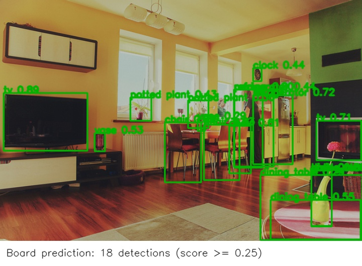
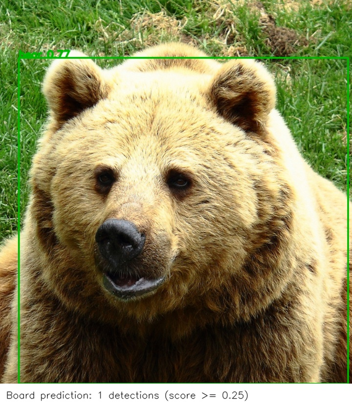
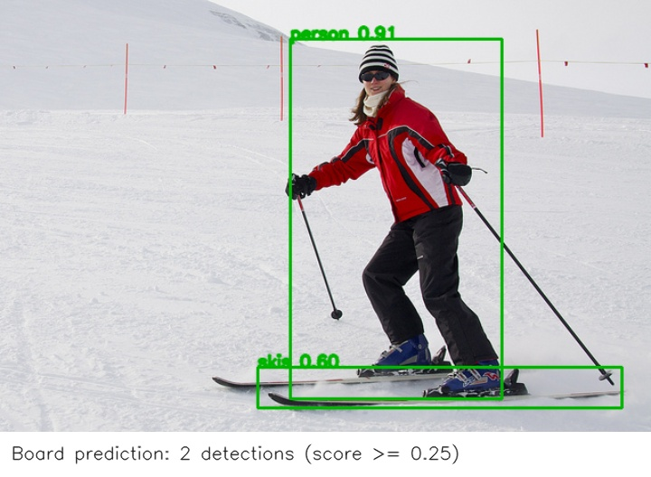

# YOLOv5s · Genio 720

> Python 推理代码已迁移,尚未做板端验证.下文报告和示例属于迁移前的 C++/原生 CLI 实现,不能作为当前 Python 实现的精度、性能或 RSS.

COCO 80 类目标检测。模型来源和许可证见[模型卡](model_card.md)。

量化方式: INT8 训练后量化 (PTQ),使用 100 张图片校准.

## 执行范围

先在已有编译容器执行 `bash deploy/compile.sh`,完成转换、量化、编译与上传后结束.随后登录开发板,在部署目录执行 `bash compile.sh`,做少量通路检查并保存 README 示例到 `examples/output/`.该阶段不计算或发布精度、性能和峰值 RSS 报告.

正式评价使用独立的 `evaluate.sh`: 容器端只计算已有浮点模型的同协议参考及必要评价输入,资源单独放入已有部署包后,板端运行 `bash evaluate.sh`,统计精度、性能和推理进程峰值 RSS.正式结果只写入 `results/summary.json`,不重新量化或编译.板端预测、日志及内部指标统一位于本模型部署目录的 work/,每次开始推理时覆盖上次中间结果.详见[板端规范](../../../../docs/genio_720.md).

下文已归档结果保留原始模型版本和评价范围,本次入口调整不代表重新实测.

## 第一步: 编译并上传

模型、数据集和部署路径见 [config.yaml](config.yaml),资源来源见 [source_url.txt](models/source_url.txt).

在编译主机的本模型目录运行:

```bash
bash deploy/compile.sh
```

入口在当前容器完成转换、DLA 编译和上传后结束,随后由用户登录开发板执行 `bash compile.sh` 生成板端示例.配置的数据目录须包含与板端相同的 COCO val2017 图片及标注。校准仅使用其中 100 张图片,与全量精度评测分开。

浮点模型只记录 mAP@0.5:0.95,不测试 PyTorch 精度,不统计编译主机耗时或内存。Docker 需安装 ONNX Runtime、pycocotools、OpenCV、PyTorch、torchvision 和 tqdm; PyTorch 仅用于解码和 NMS。模型产物写入配置指定的 NAS 资源目录。脚本不下载模型或数据。

## 第二步: 独立评价

上传完成后,请登录开发板,在部署目录执行 `bash compile.sh` 完成通路检查和示例生成.正式评价前,按[板端规范](../../../../docs/genio_720.md)准备同协议参考及必要输入,在已部署目录执行:

```bash
bash evaluate.sh
```

精度、性能和峰值 RSS 统一保存到 results/summary.json,板端过程数据位于本模型部署目录的 work/,每次开始推理时覆盖,不重新量化或编译.

## 数据与精度评测

正式报告写入部署目录的 `results/summary.json`。测试要求 `BOARD_DATASET_DIR/images/` 中有 5000 张 COCO val2017 图片、`BOARD_DATASET_DIR/annotations/instances_val2017.json`，板端还需 `pycocotools`、NumPy 和 OpenCV。

## 当前测试结果

结果来自 [results/summary.json](results/summary.json),运行编号 `20261008_032807_67603`,COCO val2017 全量 5000 张图片。

| 指标 | 本次结果 |
| --- | ---: |
| 板端 NPU 平均推理耗时 | **9.76 ms** |
| 板端推理进程峰值 RSS | **33.23 MiB** |
| ONNX FP32 mAP@0.5:0.95 | **37.09%** |
| 板端 mAP@0.5:0.95 | **35.86%** |
| 精度变化 (百分点) | **-1.23** |

ONNX FP32 与板端精度均来自本次同协议 COCO val2017 全量实测。mAP 以百分比显示并保留两位小数,精度变化按原始数值计算,负数表示下降。`summary.json` 保留完整数值精度,已纳入 Git 管理。

NPU 耗时统计预热后 5000 张图片的 `NeuronRuntime_inference` 调用,不含图片读取、前后处理和 COCOeval。峰值内存为板端 C++ 推理进程峰值 RSS,包含运行库与前后处理,不代表 NPU 专用内存。

评价结果只保存在部署目录的 `results/summary.json`.板端预测、日志和中间指标统一保存在本模型部署目录的 `work/`,每次开始推理时覆盖;展示示例保存在 `examples/output/`.取回唯一报告后据实更新 README.

## 效果示例

选取 COCO val2017 中的室内、熊和滑雪三张图片,直接复用全量评测的板端预测生成检测效果,无需单独测试或额外推理.

输入见 `examples/input/`,样本清单在编译时自动生成并随部署上传,不纳入 Git.新效果图保存在部署目录的 `examples/output/`,取回本模型同名目录后更新展示.

### 示例 1: 室内场景



### 示例 2: 熊



### 示例 3: 滑雪场景



示例来自 [COCO val2017](https://cocodataset.org/#download),原图地址和各图片许可记录在输入清单中.展示分数阈值为 0.25,不改变全量精度评测协议.

示例渲染和 COCO 评价均读取本次过程目录 `work/predictions.json` 中的 JSON 数组预测,不生成或依赖 `predictions.jsonl`.已有少量推理结果时,可在板端单独执行 `MTK_EVAL_SCOPE=subset python3 board/render_examples.py --run-id <运行编号>` 补生成示例,无需重新推理.

## 板端部署结构

第一步上传到 `BOARD_DEPLOY_DIR` 后的布局统一为:

```text
部署目录/
├── compile.sh
├── evaluate.sh          # 独立精度、性能与 RSS 评价.
├── config.json          # 不含连接地址的模型配置.
├── models/              # 模型与推理所需参数.
├── board/               # 板端程序、评测代码及必要依赖.
├── examples/            # 少量输入、来源清单和展示输出.
└── results/summary.json  # 唯一正式评价报告.
```

评价结果只保存在部署目录的 `results/summary.json`.板端预测、日志和中间指标统一保存在本模型部署目录的 `work/`,每次开始推理时覆盖;展示示例保存在 `examples/output/`.取回唯一报告后据实更新 README.
## 文件结构

- `deploy/compile.sh`: 编译部署与展示示例入口;精度、性能和 RSS 使用独立的 `deploy/evaluate.sh`.
- `deploy/host/`: 编译主机使用的导出、转换与辅助工具.
- `deploy/board/`: 板端程序源码、预处理和评测代码.
- `models/`: 原始权重、转换产物与来源说明; 必要的上游源码放在 `models/upstream/`.
- `examples/`: 少量固定输入与实际板端效果输出.
- `results/summary.json`: 上传后的最新测试汇总.

### 输出误差统计

`evaluate.sh` 同时计算 CosSim、RMSE 和 NRMSE,写入唯一 `results/summary.json` 的 `output_comparison`.浮点参考生成时保存 output_reference.sqlite,与任务参考一起放入板端 models/;按量化前输入内容配对,在现有 NPU 评价过程中逐输出累计统计.NRMSE 使用 `RMSE / RMS(浮点参考输出) × 100%`;多输出分别统计,缺参考如实记录缺失.具体定义、资源位置及当前未实测边界见[输出误差统计](../../../../docs/output_metrics.md).本次仅增加统计代码,未重新执行评价,历史指标不代表新增统计已验证.
