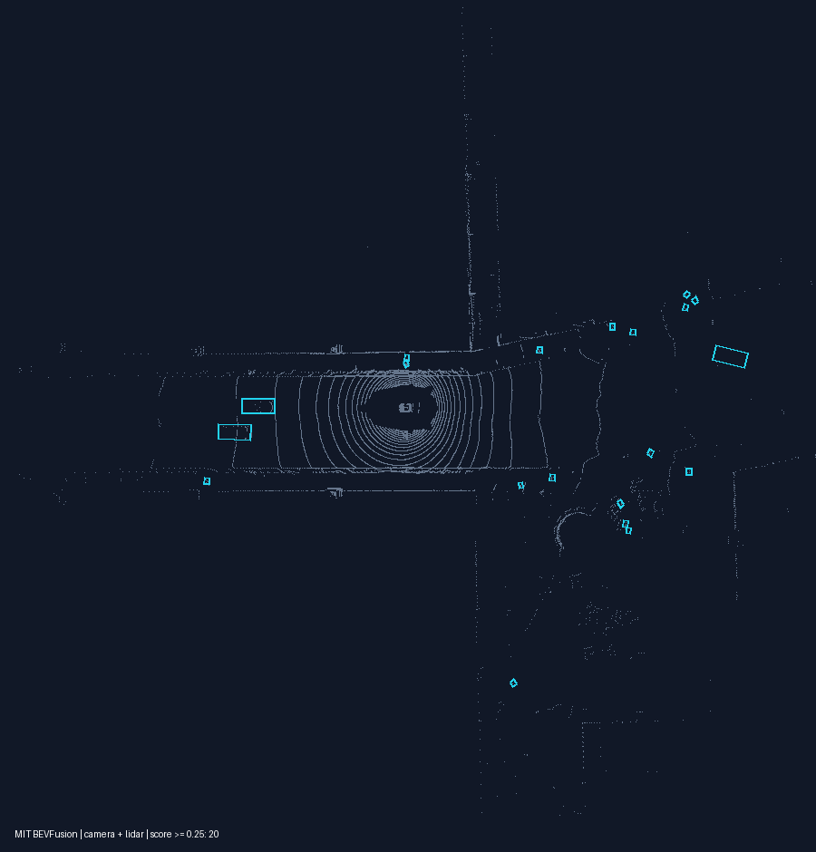

# MIT BEVFusion

已完成 G720 的 CPU + NPU 混合编译及一帧完整板端通路检查.正式权重为 MIT 官方 `bevfusion-det.pth`,固定相机与 LiDAR 融合检测配置;[模型卡](model_card.md)说明版本,张量协议和限制.

| 部分 | 当前执行位置 |
| --- | --- |
| SwinTiny + LSSFPN + DepthLSS 相机特征 | CPU / ONNX Runtime FP32 |
| LiDAR 体素化,稀疏主干 | CPU / NumPy FP32 |
| 标定几何,深度投影,BEV pooling,查询选择,框解码 | CPU / Python |
| 相机 BEV 降采样 | G720 NPU / FP16 |
| ConvFuser + SECOND + SECONDFPN + 稠密热图 | G720 NPU / FP16 |
| TransFusion 注意力与回归 | G720 NPU / FP16 |

当前 Converter 不支持原生 `SparseConvolution` 和 `ScatterND`;相机完整子图也未通过 NCC 的禁止桥接编译.因此保留这些部分的 CPU 实现,没有省略 LiDAR 或相机分支.三个实际 DLA 总大小 13.43 MB,这不包含必需的 CPU 模型与参数,不能当作完整模型大小.

## 编译与板端示例

公共环境和资源路径由本地配置读取,在已有编译容器内执行:

```bash
bash models/pointcloud/three_d_fusion/mit_bevfusion/deploy/compile.sh
```

入口离线加载已有权重,核对完整参数覆盖,导出四个 FP32 ONNX,尝试 MDLA 5.3 FP16 编译,准备现有 nuScenes 数据的固定子集,计算浮点精度并上传.随后由本模型的 host/upload.py --inputs 按样本清单同步必需的相机、LiDAR 和历史 sweep 文件至板端配置的数据集目录,保留官方相对路径,并核对全部文件大小及同一份清单;重跑使用 rsync 校验复用已有文件,不删除数据集其他资源.不自动执行板端推理.登录开发板后进入本模型部署目录执行:

```bash
bash compile.sh
```

板端通过 Python 调用 SDK 动态库,使用一帧真实数据检查三个 NPU 子图的原生缓冲区与浮点图,执行完整六相机和 LiDAR 链路,保存 `examples/output/bev.png` 和检测框资源.另对同一固定子集评分,将 mAP、NDS、精度损失及单帧子图数值误差写入 `results/summary_test.json`,不执行专项性能或 RSS 测量.

2026-10-23 已实际通过一帧 `mini_val`,sample token `3e8750f331d7499e9b5123e9eb70f2e2`,输出 200 个候选框.三个 NPU 子图均通过 FP16 原生布局及浮点子图数值检查.另有小尺寸 SubM 与两种 stride/padding 稀疏卷积的独立稠密卷积对照,最大绝对误差约 `3e-6`.这些检查不等同完整官方框架精度对齐.



## nuScenes 数据结论

现有 NAS 的 nuScenes 数据适用于该模型.已解压的 `v1.0-mini` 可用于编译示例: 十个场景 404 帧,官方 `mini_val` 为两个场景 81 帧.已核对六路相机,LIDAR_TOP,历史 sweep 和标定引用;首帧无历史按官方规则补齐.

正式精度必须使用 `v1.0-trainval/val` 的 150 场景 6019 帧.现有 trainval 元数据已解压,十个 blobs 压缩包尚未形成可直接评价的完整 `samples/` 与 `sweeps/` 数据树.开始全量评价前需要完成解压并保持官方相对目录,本次没有进行大包解压或全量推理.不需要为检测任务另外准备 lidarseg,panoptic 或 CAN bus 标签.

## 独立评价

完整评价由用户运行.先在本模型 `config.yaml` 选择已解压的 trainval 数据根目录,设置 `version: v1.0-trainval` 和 `split: val`;板端配置的数据目录应包含同一批 `samples/` 与 `sweeps/`.评价依赖为 [nuScenes devkit 1.2.0](https://pypi.org/project/nuscenes-devkit/1.2.0/),具体版本见 `deploy/requirements-evaluate.txt`.compile 的子集评分和 evaluate 的全量评分都需要该包.依赖隔离在 `$HOME/.local/share/mtk_models/bevfusion-evaluation`,由本模型两个 Shell 入口加载,不覆盖共享 NumPy、OpenCV 或 MTK SDK.

在编译容器内执行:

```bash
bash models/pointcloud/three_d_fusion/mit_bevfusion/deploy/evaluate.sh
```

主机入口预检全部文件,在本地日期过程目录生成样本清单、标注和同协议 FP32 参考.已有同模型同协议参考时直接复用,不重复推理.主机处理完整元数据,板端仅加载评分必需标注,避免在板端展开整个 trainval 原始数据库.

入口自动上传必要参考、样本清单和评分标注至板端 `build/reference/`,无需手工搬运或重新编译模型.板端配置的数据集根目录仍须具备实际传感器输入文件.在板端部署目录执行:

```bash
bash evaluate.sh
```

板端评价覆盖 6019 帧,复用 nuScenes 官方类别距离,空点框及 bicycle rack 过滤和评分算法,仅生成 `results/summary.json`.报告包含 mAP,NDS,同协议参考及百分点变化,每帧 NPU 调用总耗时,不含文件加载和图像预处理的完整推理耗时,以及评分前采集的 Python 推理进程峰值 RSS.缺少匹配参考时在推理前停止;缺少样本直接停止,不跳过或改用 mini.

目前没有正式精度,性能和 RSS 结果,所以仓库没有创建 `results/summary.json`.本次仅验证入口、依赖和轻量评分接口,没有重新执行全量模型推理.

### 输出误差统计

compile.sh 独立对固定少量输入比较浮点与 NPU 输出,在终端显示 CosSim、RMSE、NRMSE 和实际覆盖范围.普通模型最多选择 5 次输入,不减少原有 compile 通路检查样本数;LLM 比较示例首个 Prefill 块的有效位置,BEVFusion 比较单帧的 NPU 子图.这些结果用于数值检查,不能代替任务精度.全量 evaluate.sh 只计算任务精度、性能和 RSS,不保存或比较全量浮点张量.

参考为普通 NPZ 数组文件,保存在编译机器本地日期临时目录并上传板端 build/reference/output_reference.npz,由下次 compile 覆盖,不使用数据库,不写入 NAS.板端中间结果仍使用本模型 build/work/.NRMSE 定义为 100 × RMSE / RMS(浮点参考),多输出分别统计.详见[输出误差统计](../../../../docs/output_metrics.md).

### compile 子集精度检查

compile.sh 使用 最多 100 帧,当前 mini_val 划分使用全部 81 帧并明确标注,复用正式评价协议.主机执行子集浮点推理,板端执行同一子集 NPU 推理,在终端打印精度和损失,并保存 results/summary_test.json.正的损失表示 NPU 变差,负值表示改善;Top-1、AP、AR 等使用浮点减 NPU 的百分点,WER 使用 NPU 减浮点的百分点,PPL 使用增量及相对增幅.

普通样本跨完整划分按固定间隔抽取,保留展示及数值检查的必要输入;LFW、ESC-50 和 MMLU 保持折、类别和学科覆盖.同一子集两端通过样本指纹核对;MMLU 固定 seed=17 分层抽样.该报告不代表全量成绩,不改写 results/summary.json.中间数据覆盖保存在本模型 build/work/,CosSim、RMSE、NRMSE 仍只比较固定少量输入.详见[输出误差统计](../../../../docs/output_metrics.md).

## 精度设置与编译命令

本模型当前是 CPU FP32 + NPU FP16 混合部署,没有做 INT8/INT16 校准量化.配置见 [config.yaml](config.yaml),导出和编译由 [compile.py](deploy/host/compile.py) 完成.

### 转换设置

| 参数 | 当前设置 |
| --- | --- |
| 转换器 | 每个 FP32 ONNX 子图分别使用 MTK `OnnxConverter` |
| 量化开关 | `quantize=False`,没有校准集和整数 scale/zero point |
| NPU 精度 | NCC `--relax-fp32` 的 FP16 路线;代码未设置 `convert_float32_weights_to_float16` |
| CPU 精度 | 相机完整子图 ONNX Runtime FP32,LiDAR 稀疏主干 NumPy FP32,几何/体素化/BEV pooling/解码由 CPU 完成 |
| 子图记录 | 每次实际后端、I/O 和编译失败原因写入 `models/contract.json`,不能仅因尝试编译就标成 NPU |

### 特殊 ONNX 导出处理

从官方 camera + LiDAR 完整权重构建四个固定子图,复用实际参数并检查全部权重覆盖.不是直接将原始完整网络导成单张 ONNX:

| 子图 | 固定输入 | 当前执行方式 |
| --- | --- | --- |
| `camera` | NHWC image `[1,256,704,3]`,depth `[1,256,704,1]` | CPU FP32,保留 SwinTiny/LSSFPN/DepthLSS |
| `camera_downsample` | `[1,360,360,80]` | NPU FP16 |
| `fusion` | camera `[1,180,180,80]`,LiDAR `[1,180,180,256]` | NPU FP16 |
| `head` | query `[1,200,128]`,position `[1,200,2]`,classes `[1,200,10]`,features `[1,32400,128]`,key position `[1,32400,2]` | NPU FP16 |

导出为 opset 13,文件为 `models/bevfusion-det_<stage>.onnx`.稀疏参数和几何常量分别保存为 `sparse_weights.npz`、`geometry.npz`;SparseConvolution、ScatterND 等未被省略,由 CPU 路线完成.原始完整相机图编译不通过时明确保留 CPU,不启用 CPU bridge 来掩盖后端差异.

### 完整 NCC 编译命令

以下三条对应当前 NPU 子图,在已配置编译容器的仓库根目录使用已有 TFLite:

```bash
source tools/storage.sh models/pointcloud/three_d_fusion/mit_bevfusion
env LD_LIBRARY_PATH="${NCC_ROOT}/lib" \
    "${NCC_ROOT}/bin/ncc-tflite" \
    --arch=mdla5.3 --suppress-output --disallow-bridge --relax-fp32 --suppress-input \
    "${MODEL_ASSETS_DIR}/build/camera_downsample.tflite" \
    -o "${MODEL_ASSETS_DIR}/models/camera_downsample.dla"

env LD_LIBRARY_PATH="${NCC_ROOT}/lib" \
    "${NCC_ROOT}/bin/ncc-tflite" \
    --arch=mdla5.3 --suppress-output --disallow-bridge --relax-fp32 --suppress-input \
    "${MODEL_ASSETS_DIR}/build/fusion.tflite" \
    -o "${MODEL_ASSETS_DIR}/models/fusion.dla"

env LD_LIBRARY_PATH="${NCC_ROOT}/lib" \
    "${NCC_ROOT}/bin/ncc-tflite" \
    --arch=mdla5.3 --suppress-output --disallow-bridge --relax-fp32 --suppress-input \
    "${MODEL_ASSETS_DIR}/build/head.tflite" \
    -o "${MODEL_ASSETS_DIR}/models/head.dla"
```

脚本对 `camera` 也尝试相同参数的命令;这是能力检查,当前没有交付其 DLA.仅在该子图 TFLite 成功生成时才进入 NCC:

```bash
env LD_LIBRARY_PATH="${NCC_ROOT}/lib" \
    "${NCC_ROOT}/bin/ncc-tflite" \
    --arch=mdla5.3 --suppress-output --disallow-bridge --relax-fp32 --suppress-input \
    "${MODEL_ASSETS_DIR}/build/camera.tflite" \
    -o "${MODEL_ASSETS_DIR}/models/camera.dla"
```
